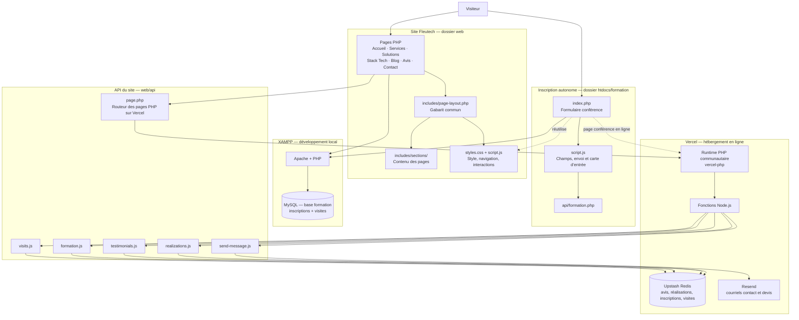
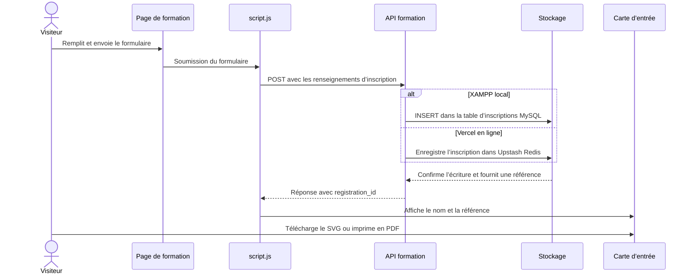

# Schéma d’assemblage du projet Fleutech

Ce document décrit l’organisation du site, le trajet des requêtes et les différences entre l’exécution locale sous XAMPP et l’hébergement sur Vercel.

## 1. Vue d’ensemble



## 2. Arborescence utile

```text
htdocs/
├── web/                         Racine du site Fleutech
│   ├── index.php                Accueil
│   ├── service.php              Services
│   ├── solution.php             Solutions
│   ├── stack-tech.php           Stack technique
│   ├── blog.php                 Blog
│   ├── avis.php                 Avis
│   ├── contact.php              Contact
│   ├── conference-ia.php        Page conférence / redirection locale
│   ├── statistiques.php         Relevé mensuel des visites
│   ├── styles.css               Style partagé du site
│   ├── script.js                Interactions partagées du site
│   ├── vercel.json              Runtime PHP et routes Vercel
│   ├── api/
│   │   ├── page.php             Routeur vers les pages PHP sur Vercel
│   │   ├── formation.js         Inscriptions sur Vercel
│   │   ├── formation.php        Relais PHP vers la formation locale
│   │   ├── realizations.js      API des réalisations
│   │   ├── testimonials.js      API des avis
│   │   ├── send-message.js      API de contact et de devis
│   │   └── visits.js            API des visites sur Vercel
│   └── includes/
│       ├── page-layout.php      Assemble le gabarit commun
│       ├── head.php             Métadonnées et feuilles de style
│       ├── header.php           Navigation
│       ├── footer.php           Pied de page
│       ├── site-visits.php      Comptage local avec MySQL
│       └── sections/            Sections réutilisables des pages
└── formation/                   Page locale de formation, hors du site web/
    ├── index.php                Formulaire autonome de conférence
    ├── script.js                Soumission et carte d’entrée
    └── api/
        └── formation.php        Validation et insertion MySQL locale
```

Le répertoire `web/storage/` est un ancien stockage local. Il est exclu des livraisons Vercel par `.vercelignore`.

## 3. Parcours d’une inscription à la conférence



## 4. Où les données sont stockées

| Fonction | XAMPP local | Vercel |
|---|---|---|
| Inscriptions conférence | MySQL, base `formation`, table `inscription a la formation ia` | Upstash Redis, clé `fleutech:formation` |
| Relevé des visites | MySQL, table `site_monthly_visits` | Upstash Redis, clés `fleutech:visits:*` et `fleutech:visitors:*` |
| Réalisations | API Vercel / Upstash Redis pour la version hébergée | Upstash Redis |
| Avis | API Vercel / Upstash Redis pour la version hébergée | Upstash Redis |
| Courriels de contact et de devis | Service d’envoi configuré par l’API | Resend |

MySQL de XAMPP n’est pas accessible depuis Vercel. Les données locales et les données de production sont donc séparées.

## 5. Déploiement Vercel

- **Root Directory** : `web`
- **Pages PHP** : runtime `vercel-php@0.9.0`, routées par `vercel.json`
- **Fonctions JavaScript** : fichiers `web/api/*.js`
- **Données hébergées** : Upstash Redis
- **Envoi de courriels** : Resend
- **Secrets et identifiants** : variables d’environnement Vercel, jamais dans le code

Variables d’environnement documentées :

- Upstash : `UPSTASH_REDIS_REST_URL`, `UPSTASH_REDIS_REST_TOKEN`
- Administration : `ADMIN_SECRET`
- Resend : `RESEND_API_KEY`, `NOTIFY_EMAIL`
- MySQL local facultatif : `FLEUTECH_DB_HOST`, `FLEUTECH_DB_PORT`, `FLEUTECH_DB_NAME`, `FLEUTECH_DB_USER`, `FLEUTECH_DB_PASSWORD`
